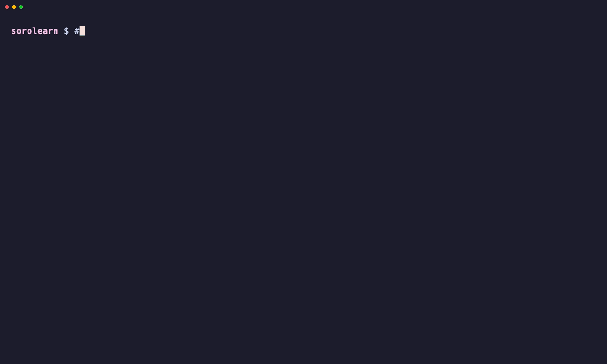

# Sorolearn 🦀✨

**AI can write your Soroban contract. Sorolearn teaches you to tell when it's wrong.**

Small, hands-on exercises for [Stellar](https://stellar.org) and its
[Soroban](https://developers.stellar.org/docs/build/smart-contracts/overview) smart contracts, inspired by [Rustlings](https://github.com/rust-lang/rustlings). Every exercise
is a tiny piece of broken code with tests: fix it, save, and Sorolearn tells you instantly whether you got it.
You start with the network itself (accounts, keys, transactions, signatures, assets), then write contracts.
It ends with a **security track** where you review plausible, AI-style contracts with planted vulnerabilities
and make the exploit tests fail, and an optional **on-chain graduation**: deploy your contract to Stellar testnet,
where a registry contract examines it and records you as a graduate.

**🌐 Website:** https://evangel90.github.io/Sorolearn/ · **🎓 Graduates (live from testnet):** https://evangel90.github.io/Sorolearn/graduates/



## Two ways to run it

### ☁️ In the browser: nothing to install

[](https://codespaces.new/Evangel90/Sorolearn)

Click the button, wait for the codespace to finish setting up, then run `sorolearn` in the terminal.
Rust, the CLI and a pre-compiled Soroban SDK are installed automatically (see `.devcontainer/`).

> Maintainers: enable **Settings → Codespaces → Prebuilds** for the default branch, so new codespaces
> start with the SDK already compiled (seconds instead of minutes).

The same dev container also works locally with VS Code's *Dev Containers* extension and Docker.

### 💻 Locally: fully offline after a one-time setup

You need [Rust](https://rustup.rs) 1.91 or newer. The course itself needs nothing else (no Stellar CLI, no
account, no blockchain connection): contracts are tested against Soroban's built-in simulated environment.
Only the optional graduation step talks to Stellar testnet, and needs the
[Stellar CLI](https://developers.stellar.org/docs/tools/cli/install-cli) (pre-installed in Codespaces).

```bash
git clone https://github.com/Evangel90/Sorolearn.git sorolearn
cd sorolearn
cargo install --path .     # installs the `sorolearn` command
sorolearn setup            # one time, needs internet: downloads + pre-compiles the Soroban SDK (~1-2 min)
sorolearn                  # start learning, works offline from here on
```

(`cargo run --release` works too, without installing anything.)

After `setup`, every build runs with `cargo --offline` against a committed lockfile (`exercises.lock`), so
Sorolearn works on a plane, behind a firewall, or at a hackathon with flaky Wi-Fi. If you skip
`setup`, it runs automatically the first time you start Sorolearn.

## How it works

1. Sorolearn shows the current exercise, e.g. `exercises/07_storage/storage1.rs`.
2. Open it in your editor. Read the comments, make it compile and the tests pass.
3. Save. Sorolearn re-runs the tests automatically.
4. When it passes, type `n` + Enter to move on.

Each topic folder has a `README.md` with the background you need, plus links to the official docs.
**Don't edit the tests** at the bottom of each file: they are the spec.

## Commands

| Command | What it does |
|---|---|
| `sorolearn` | Watch mode (recommended) |
| `sorolearn list` | All exercises and your progress |
| `sorolearn run [name]` | Compile & test one exercise |
| `sorolearn hint [name]` | Show a hint |
| `sorolearn reset <name>` | Restore an exercise to its original state |
| `sorolearn verify` | Check all exercises in order |
| `sorolearn setup` | One-time download + pre-build (enables offline use) |
| `sorolearn build-wasm <name>` | Compile an exercise to a deployable `.wasm` |
| `sorolearn graduate [identity]` | Deploy your quiz1 to testnet and take the on-chain exam |

## Curriculum

| # | Topic | Exercises | You'll learn |
|---|---|---|---|
| 00 | Intro | intro1-2 | `#[contract]`, `#[contractimpl]`, `Env`, test clients |
| 01 | **Stellar: accounts** | accounts1-3 | lumens & stroops, reserves, ed25519 keys, StrKeys (`G…`/`S…`/`C…`/`M…`), multisig thresholds |
| 02 | **Stellar: transactions** | transactions1-2 | operations, sequence numbers, fees, memos, XDR, network-specific hashing, signing |
| 03 | **Stellar: assets** | assets1 | classic assets, codes & issuers, trustlines, the `CODE:ISSUER` text form |
| 04 | Functions | functions1-2 | exported functions, allowed argument types |
| 05 | Types | symbols1, vecs1, maps1, bytes1 | `Symbol`, `Vec`, `Map`, `Bytes`, `String` |
| 06 | Custom types | types1-2 | `#[contracttype]` structs and enums |
| 07 | Storage | storage1-3 | instance / persistent / temporary storage, `DataKey`, TTL |
| 08 | Errors | errors1-2 | `#[contracterror]`, `Result`, `panic_with_error!`, checked math |
| 09 | Auth | auth1-2 | `require_auth`, admin pattern, `__constructor` |
| 10 | Events | events1 | `#[contractevent]`, topics vs data |
| 11 | Tokens | tokens1-2 | `TokenClient`, contracts holding funds, regulated classic assets (AUTH_REQUIRED) via the SAC |
| 12 | Cross-contract | cross1 | calling other contracts |
| 13 | Time | time1 | ledger timestamp vs sequence |
| ⭐ | Quizzes | quiz1 (poll), quiz2 (time-locked vault) | putting it all together |
| 14 | **Security: review the AI** | audit_auth, audit_init, audit_amount, audit_storage, audit_token | spotting and fixing the bugs AI-generated contracts actually ship with |
| 15 | **Testnet & graduation** | `sorolearn graduate` + a classic Stellar lab | issue an asset, trustlines, payments, the SAC, Wasm deploys, an on-chain exam |

The Stellar lessons (`01`-`03`) are plain Rust against the real Stellar types (`soroban_sdk::xdr`,
`stellar-strkey`, `ed25519-dalek`). Their expected values, such as a derived address and a
transaction hash, were checked against the Stellar CLI.

### On-chain graduation

Finishing the course locally is self-reported. Graduating is not: `sorolearn graduate` builds your `quiz1` poll
to WebAssembly, uploads it to **Stellar testnet** and calls the **Sorolearn registry** contract
(`CD23Z2JCHQHLJOXWAWOV4NFMAL3N5YRDCGLBGHLKD62X5QUCHDYPFWYY`). The registry deploys a fresh copy of your code,
**examines it with cross-contract calls** (votes, tries to double-vote, checks the tally), and only then records
you and emits a `Graduated` event. Anyone can verify a graduate on-chain or on the
[graduates page](https://evangel90.github.io/Sorolearn/graduates/). The command prints every Stellar CLI step it runs;
`exercises/15_testnet/README.md` walks through doing them by hand. The registry's source and tests are in
`registry/`.

### The security track

AI tools write Soroban contracts that compile and look right, but miss things that cost real money. Each
`14_security` exercise is a plausible AI-style contract with one planted vulnerability. Its `happy_path`
tests pass. Its `exploit_` test reproduces an attack and fails until you fix the contract:

| Exercise | Vulnerability |
|---|---|
| `audit_auth` | `require_auth` on the wrong address: anyone can drain any account |
| `audit_init` | re-callable `initialize`: attacker takes over the admin role |
| `audit_amount` | negative `i128` amounts pass the balance check: free money |
| `audit_storage` | balances in temporary storage + no TTL extension: savings vanish |
| `audit_token` | trusting a caller-supplied token contract: vault drained with a fake token |

Reference solutions live in `solutions/`. That's a deliberate choice (Rustlings does the same): after you
pass an exercise, comparing your fix with the reference is part of learning. Try not to peek before then!

## Project layout

```
info.toml            exercise order + hints
exercises/<topic>/   the files you edit (+ README.md per topic)
solutions/<topic>/   reference solutions
src/                 the sorolearn CLI
exercises.lock       pinned dependency versions for the exercise crates
registry/            the on-chain graduation registry contract (+ tests)
docs/                the website (GitHub Pages); docs/graduates/ reads testnet directly
.devcontainer/       Codespaces / Dev Containers setup
.sorolearn/          generated Cargo workspace, build cache and progress (git-ignored)
```

Each exercise is a single `.rs` file. The CLI generates a hidden workspace in `.sorolearn/` with one
package per exercise (`[lib] path = "…/exercises/…"`), all sharing one target dir, so the SDK is
built only once.

## Contributing exercises

1. Write the solution in `solutions/<topic>/<name>.rs` (a `#![no_std]` contract + `#[cfg(test)] mod tests`).
2. Copy it to `exercises/<topic>/<name>.rs` and break it in an instructive way.
3. Add an `[[exercises]]` entry with a hint to `info.toml`.
4. Run `cargo run -- dev check`: every solution must pass and every exercise must fail.

All exercises target `soroban-sdk` 29.0.0 (protocol 29, which testnet and mainnet currently run).
After changing the SDK version in `src/info.rs`, delete `exercises.lock`, run `sorolearn setup`, and copy
`.sorolearn/exercises/Cargo.lock` back to `exercises.lock`.
